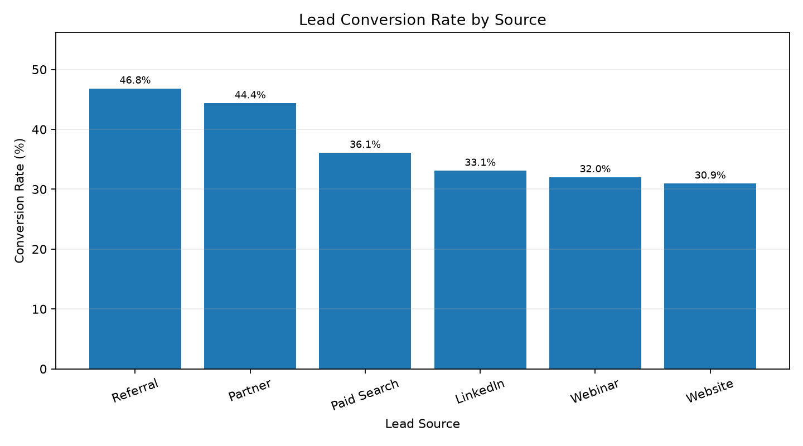
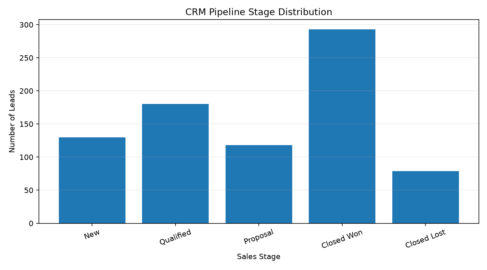
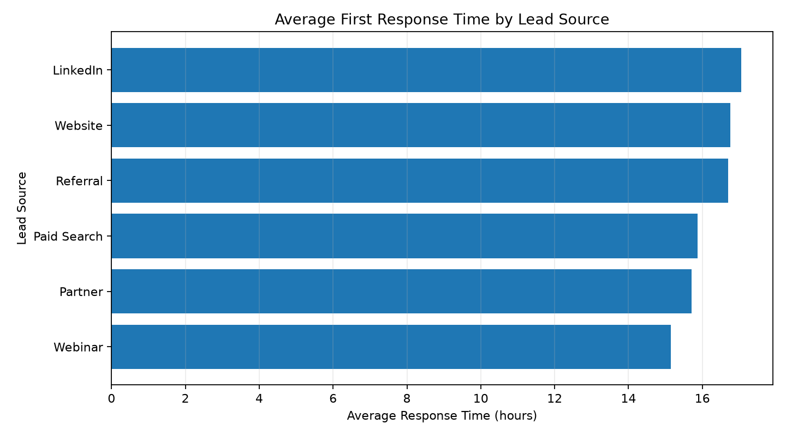

# OpsPulse
## Business Operations Intelligence & Lead Analytics Platform

OpsPulse is a reproducible Python portfolio project that demonstrates an end-to-end business operations intelligence workflow. It validates CRM data, calculates operational KPIs, stores records in SQLite, generates analytical reports, and applies an interpretable machine-learning baseline to lead conversion analysis.

The project focuses on connecting data processing, business analytics, machine learning, and operational decision support in one modular application.

> **Data Notice:** The bundled CRM dataset is entirely synthetic. It contains no Apple data, real customer information, or confidential business records. All reported metrics are demonstration results and do not represent production performance.

## 1. Project Objectives

OpsPulse demonstrates how a business-data workflow can transform structured CRM records into useful operational insights.

The main objectives are to:

- Validate incoming CRM records and identify data-quality issues.
- Measure business performance using operational KPIs.
- Analyze lead conversion, response times, sales funnels, and regional performance.
- Apply an interpretable machine-learning baseline to lead conversion analysis.
- Evaluate model performance using a held-out test dataset.
- Generate out-of-fold scores for historical demonstration records.
- Persist CRM data and analytical results using SQLite.
- Produce reproducible reports and visualizations.

## 2. Core Capabilities

| Component | Capabilities |
|---|---|
| Data Ingestion | CSV loading and schema validation |
| Data Quality | Missing-value and duplicate-ID checks |
| Business Analytics | Conversion rate, pipeline value, response time, and funnel analysis |
| Machine Learning | Logistic Regression with a preprocessing pipeline |
| Model Evaluation | Accuracy, Precision, Recall, F1-score, ROC-AUC, and confusion matrix |
| Historical Lead Scoring | Stratified out-of-fold predictions |
| Model Interpretation | Logistic-regression coefficients and odds ratios |
| Database | SQLite persistence and SQL aggregations |
| Visualization | Matplotlib analytical charts |
| Testing | Automated tests using pytest |

## 3. Technology Stack

- Python
- pandas
- NumPy
- scikit-learn
- Matplotlib
- SQLite
- SQL
- Joblib
- pytest

## 4. Architecture

The application follows a modular, object-oriented structure.

```text
CRM CSV Input
      |
      v
CRMDataLoader
      |
      v
Data Validation
      |
      v
OpsPulsePipeline
      |
      +------------------------+
      |                        |
      v                        v
OperationsAnalyzer       LeadConversionModel
      |                        |
      v                        v
Business KPIs             Model Evaluation
      |                        |
      |                        v
      |                  Out-of-Fold Scoring
      |                        |
      +------------+-----------+
                   |
                   v
              ReportBuilder
                   |
        +----------+----------+
        |          |          |
        v          v          v
      CSV/JSON    Charts    SQLite
        |
        v
   Final Reports
```

### Main Modules

| Module | Responsibility |
|---|---|
| `data.py` | CSV loading and data validation |
| `analytics.py` | Business KPI calculations and insights |
| `model.py` | Preprocessing, Logistic Regression, evaluation, and scoring |
| `pipeline.py` | Orchestrating the end-to-end workflow |
| `reporting.py` | Generating reports, charts, and model artifacts |
| `charts.py` | Creating visualizations |
| `storage.py` | SQLite data persistence |
| `__main__.py` | Command-line application entry point |

## 5. Machine Learning Approach

OpsPulse uses Logistic Regression as an interpretable baseline for lead conversion analysis.

### Features

The model uses seven input features:

**Categorical features**
- Region
- Industry
- Company size
- Lead source

**Numerical features**
- Response time in hours
- Number of interactions
- Previous purchases

The target variable is `converted`.

The following fields are intentionally excluded from model inputs:

- `sales_stage`
- `deal_value_usd`

This helps reduce target leakage from sales-stage and deal-value information that may not be available at the intended prediction point.

### Preprocessing

The scikit-learn pipeline applies:

- One-Hot Encoding for categorical variables.
- StandardScaler for numerical variables.
- Logistic Regression with `class_weight="balanced"`.

The preprocessing operations are fitted within the model pipeline to prevent information from the test or validation folds from influencing preprocessing during evaluation.

### Model Evaluation

The model is evaluated using a stratified 75/25 train/test split with a fixed random seed.

The current synthetic demonstration run produced:

| Metric | Result |
|---|---:|
| Training records | 600 |
| Testing records | 200 |
| Accuracy | 64.0% |
| Precision | 50.5% |
| Recall | 63.0% |
| F1-score | 56.1% |
| ROC-AUC | 69.0% |

These results represent a baseline demonstration on synthetic data, not evidence of real-world predictive performance.

### Historical Lead Scoring

Historical lead scores are generated using five-fold Stratified Out-of-Fold (OOF) predictions.

Each record receives a prediction from a model that was not trained on that particular record.

This avoids reporting in-sample training predictions as independent historical lead scores.

The application also fits a final model on the complete available dataset. This serialized model is intended as a demonstration artifact for scoring new, compatible lead records.

The generated lead scores are model estimates, not guaranteed outcomes or calibrated probabilities.

## 6. Business Intelligence Outputs

OpsPulse calculates and reports several business indicators:

- Lead conversion rate
- Conversion performance by acquisition source
- Regional conversion performance
- Average first-response time
- Sales pipeline value
- Lead distribution across sales stages
- Historical lead conversion scores

The analytical reports are intended to support business investigation and operational decision-making.

## 7. Generated Output Files

The application generates a report bundle in `outputs/`.

| File | Description |
|---|---|
| `kpi_summary.json` | Main operational KPIs |
| `source_performance.csv` | Performance by lead source |
| `sales_funnel.csv` | Lead distribution by sales stage |
| `region_performance.csv` | Regional performance metrics |
| `lead_scores.csv` | Historical OOF scores and priority bands |
| `model_evaluation.json` | Held-out model metrics and confusion matrix |
| `model_coefficients.csv` | Model coefficients and odds ratios |
| `key_insights.json` | Descriptive business observations |
| `data_quality_report.json` | Data validation results |
| `sql_source_performance.csv` | SQL-based source performance analysis |
| `opspulse.sqlite` | SQLite database |
| `lead_conversion_model.joblib` | Serialized final scikit-learn pipeline |
| `conversion_by_source.png` | Conversion rates by source |
| `sales_funnel.png` | Sales funnel visualization |
| `response_time_by_source.png` | Response times by source |

### Visual Results

#### 1. Lead Conversion by Source



#### 2. Sales Funnel Analysis



#### 3. Response Time by Lead Source




## 8. Installation and Execution

### Requirements

- Python 3.10 or newer
- pip

### Step 1: Clone the repository

```bash
git clone https://github.com/Mohsen-Sajjadi-ai/OpsPulse.git
cd OpsPulse
```

### Step 2: Create a virtual environment

```bash
python -m venv .venv
```

Activate it:

**Windows PowerShell**

```powershell
.venv\Scripts\Activate.ps1
```

**macOS / Linux**

```bash
source .venv/bin/activate
```

### Step 3: Install dependencies

```bash
python -m pip install -r requirements.txt
```

### Step 4: Run the application

```bash
python -m opspulse
```

The default configuration reads:

```text
sample_data/crm_leads.csv
```

Generated reports are saved to:

```text
outputs/
```

To specify a different input file and output directory:

```bash
python -m opspulse --input path/to/crm_export.csv --output path/to/report_folder
```

The input CSV must comply with the schema defined in `docs/data_dictionary.md`.

## 9. Regenerate Synthetic Data

To regenerate the demonstration dataset:

```bash
python generate_sample_data.py
```

The generator uses a fixed random seed by default to support reproducibility.

## 10. Automated Testing

Run the automated test suite:

```bash
python -m pytest -q
```

The current test suite contains six tests covering:

- Data loading and validation
- Duplicate lead-ID detection
- Negative response-time validation
- Business analytics calculations
- Machine-learning evaluation and scoring
- Out-of-fold historical lead scoring

**Latest local test result: 6 passed.**

## 11. Project Structure

```text
opspulse_project/
|
|-- opspulse/
|   |-- __init__.py
|   |-- __main__.py
|   |-- analytics.py
|   |-- charts.py
|   |-- data.py
|   |-- model.py
|   |-- pipeline.py
|   |-- reporting.py
|   |-- storage.py
|
|-- sample_data/
|   |-- crm_leads.csv
|
|-- tests/
|   |-- test_analytics.py
|   |-- test_data.py
|   |-- test_model.py
|
|-- docs/
|-- outputs/
|-- generate_sample_data.py
|-- requirements.txt
|-- pytest.ini
|-- README.md
```

## 12. Limitations and Responsible Use

OpsPulse is a portfolio and learning demonstration, not a production CRM or automated decision-making system.

Important limitations include:

- The bundled dataset is synthetic and may not represent real business behavior.
- The reported model metrics should not be generalized to real customer populations.
- Historical out-of-fold scores are not a substitute for prospective evaluation on future data.
- Predicted scores have not been established as calibrated probabilities.
- Real deployment would require representative and lawfully obtained data, privacy safeguards, bias analysis, drift monitoring, calibration, and human oversight.

The lead scoring output should be treated as an analytical signal rather than a decision to accept or reject a customer.

## 13. Portfolio Summary

OpsPulse demonstrates an end-to-end Python business intelligence workflow that connects CRM data validation, operational analytics, machine learning, SQL storage, and automated reporting.

The project emphasizes modular software design, reproducible execution, interpretable baseline modeling, and transparent reporting of limitations.

It was developed as an independent portfolio project. It is not affiliated with, endorsed by, or built using proprietary data from Apple.

## 14. Interview Walkthrough

For a technical walkthrough, see:

- `docs/interview_guide.md`
- `docs/model_card.md`
- `docs/data_dictionary.md`

Suggested demonstration sequence:

1. Explain the CRM input schema and data-quality checks.
2. Demonstrate the modular application architecture.
3. Review operational KPIs and business insights.
4. Explain the feature selection and target-leakage considerations.
5. Demonstrate the Logistic Regression pipeline.
6. Explain held-out evaluation and out-of-fold scoring.
7. Show SQLite persistence and SQL aggregations.
8. Discuss synthetic-data limitations and requirements for real deployment.

---

**Project:** OpsPulse  
**Category:** Business Intelligence | Information Systems | Applied Machine Learning  
**Implementation:** Python